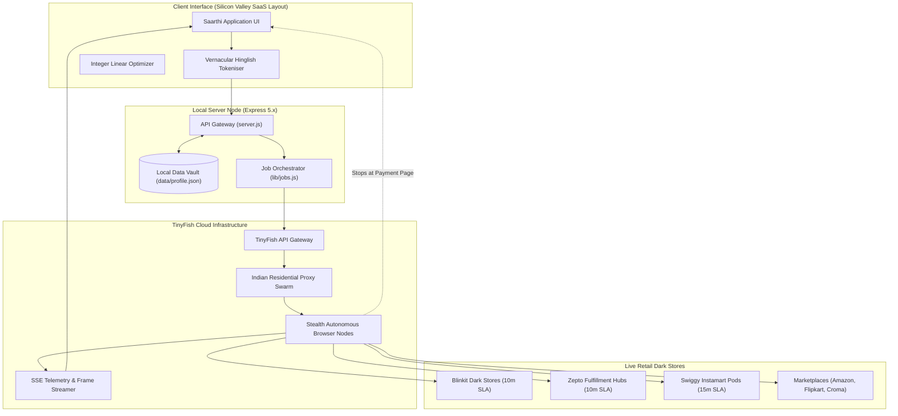
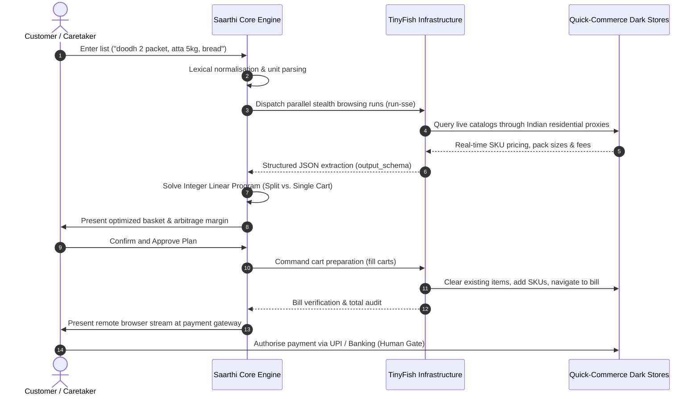

<p align="center">
  
</p>

<h1 align="center">Saarthi</h1>

<p align="center">
  <strong>Autonomous Multi-Platform Quick-Commerce Concierge &amp; Integer Linear Arbitrage Engine</strong>
</p>

<p align="center">
  <em>Powered by TinyFish Stealth Web Agent Infrastructure</em>
</p>

---

## Abstract

Saarthi is an autonomous, non-custodial web agent designed to eliminate the market fragmentation, price disparity, and friction inherent in modern on-demand commerce. Operating across major Indian quick-commerce and retail networks—including Blinkit, Zepto, Swiggy Instamart, BigBasket, Amazon India, Flipkart, and Tata 1mg—Saarthi parses vernacular natural language procurement lists, orchestrates parallel autonomous browser agents via the TinyFish infrastructure, solves an integer linear optimization problem over real-time catalog pricing and delivery fee thresholds, and pre-populates target carts ready for human-authorised settlement.

The system is fundamentally non-custodial: credentials, addresses, and user profiles remain strictly air-gapped within local storage, whilst all automated interaction ceases immediately upon reaching the retailer payment gateway.

---

## Retail Ecosystem Integration

Saarthi interfaces directly with India's primary quick-commerce, supermarket, pharmaceutical, and consumer electronics ecosystems:

<div align="center">
  <table>
    <tr>
      <td align="center" width="160">
        <br />
        <sub><b>Blinkit</b><br />10–15 Min Dark Store</sub>
      </td>
      <td align="center" width="160">
        <br />
        <sub><b>Zepto</b><br />10 Min Hyper-Local</sub>
      </td>
      <td align="center" width="160">
        <br />
        <sub><b>Swiggy Instamart</b><br />15 Min Grocery Pod</sub>
      </td>
      <td align="center" width="160">
        <br />
        <sub><b>BigBasket</b><br />Instant &amp; Scheduled</sub>
      </td>
    </tr>
    <tr>
      <td align="center" width="160">
        <br />
        <sub><b>Amazon India</b><br />Pan-India Marketplace</sub>
      </td>
      <td align="center" width="160">
        <br />
        <sub><b>Flipkart</b><br />Retail &amp; Minutes</sub>
      </td>
      <td align="center" width="160">
        <br />
        <sub><b>Tata 1mg</b><br />Digital Pharmacy</sub>
      </td>
      <td align="center" width="160">
        <br />
        <sub><b>JioMart</b><br />Omnichannel Grocery</sub>
      </td>
    </tr>
    <tr>
      <td align="center" width="160">
        <br />
        <sub><b>Croma</b><br />Consumer Electronics</sub>
      </td>
      <td align="center" width="160">
        <br />
        <sub><b>Reliance Digital</b><br />Electronics Retail</sub>
      </td>
      <td align="center" width="160" colspan="2">
        <br />
        <sub><b>IndiaMART</b><br />B2B Wholesale &amp; Direct Sourcing</sub>
      </td>
    </tr>
  </table>
</div>

---

## How TinyFish Empowers Saarthi

Modern quick-commerce platforms deploy enterprise-tier perimeter defenses (including Cloudflare Turnstile, DataDome, Akamai, and Kasada) designed to reject datacenter traffic, identify automated head-signatures, and terminate programmatic sessions. Standard web scraping and serverless HTTP scrapers fail decisively against these mechanisms.

Saarthi solves this challenge by delegating remote execution to **TinyFish**, an enterprise agentic browsing platform providing specialized primitives:

```
[Saarthi Orchestrator]
       |
       +---> TinyFish Agent API (run-sse)
       |        |
       |        +---> Residential Node Mesh (India ISP Tier-1/Tier-2)
       |        +---> Stealth CDP Browser Context (Fingerprint Cloaking)
       |        +---> Vision-Language Extraction (Structured JSON Schema)
       |        +---> Live WebRTC / CDP Stream Forwarding
       |
       v
[Target Retail Platforms: Blinkit, Zepto, Instamart, Amazon...]
```

### 1. Residential Network Geo-Proxies
Every TinyFish browser session is dispatched through authentic residential IP pools situated within the Indian territory (`proxy_country_code: "IN"`). Request traffic mirrors genuine broadband and mobile subscribers, circumventing rate-limiting heuristics and perimeter geo-blocking.

### 2. Isolated Browser Context Profiles (`Browser Context Profiles`)
Rather than persisting plaintext session tokens or customer login credentials, Saarthi utilizes TinyFish's persistent browser context profiles (`createProfile`, `startProfileSetup`). When a user authenticates once via SMS OTP, cookies and session tokens remain securely encapsulated within the remote profile container. Sub-agents reuse these profiles via `use_profile: profile_id` to populate live carts directly within the authenticated user session.

### 3. Server-Sent Events (SSE) Execution Telemetry
During multi-store execution, TinyFish streams structured event sequences (`run-sse`), DOM mutation events, and high-frequency JPEG viewport captures over Server-Sent Events (`/v1/runs/{id}/stream`). This allows Saarthi to present live agent introspection panels in the user interface with negligible latency.

### 4. Deterministic Schema Enforcement (`output_schema`)
TinyFish constrains multimodal vision-language models using strict JSON Schema specifications. Rather than unconstrained text responses, the agent returns typed records containing exact SKU denominations, normalized quantities, base unit pricing, maximum retail prices, stock availability flags, and real-time delivery fees.

### 5. Non-Custodial Payment Handoff
TinyFish automation halts unconditionally upon detecting payment gateway components (e.g., UPI intents, Razorpay / PayU modals, or 3D-Secure challenges). The active browser context is forwarded directly to the client interface via a secure Chrome DevTools Protocol stream, allowing the human user to execute UPI authorization or card confirmation with absolute authority.

---

## System Architecture



---

## Algorithmic Workflow & Optimization Model

### 1. Natural Language Procurement Parsing
The ingest pipeline accepts unstructured colloquial text (e.g., `"doodh 2 packet, 1kg tamatar, bread, maggi 4 pack, aashirvaad atta 5kg"`) and performs grammatical entity normalization:
* **Token Normalization:** Standardizes colloquial variants (`"doodh"`, `"tamatar"`, `"chawal"`, `"ande"`) into canonical commodity descriptors (`milk`, `tomato`, `rice`, `eggs`).
* **Metric Coercion:** Standardizes dimensional expressions into base units (`grams`, `millilitres`, `pieces`), factoring multi-pack multipliers (e.g., `"4 x 70 g"` to `280 g`).
* **Substitution Policies:** Marks items with strict brand adherence (`allowSubstitute: false`) or flexible equivalence.

### 2. Multi-Store Agent Dispatch
Saarthi instantiates parallel TinyFish agent workers per target network. Each worker initiates navigation from the platform home page using verified residential exit nodes, resolving search queries against physical dark store micro-inventories determined by the destination postal code.

### 3. Integer Linear Arbitrage Model
Rather than naively selecting the lowest unit price per item, Saarthi formulates multi-store cart allocation as an integer programming problem:

Given a set of items $I = \{1, \dots, n\}$ and retail stores $S = \{1, \dots, m\}$, let $x_{i,s} \in \{0, 1\}$ denote whether item $i$ is procured from store $s$.

The objective is to minimize the total expenditure $Z$:

$$\min Z = \sum_{s \in S} \left( \sum_{i \in I} x_{i,s} \cdot p_{i,s} + y_s \cdot D_s(C_s) + y_s \cdot H_s + y_s \cdot M_s(C_s) \right)$$

Subject to:
1. **Item Fulfillment Constraint:**
   $$\sum_{s \in S} x_{i,s} = 1, \quad \forall i \in I \text{ (where item } i \text{ is in stock)}$$
2. **Store Activation Variable:**
   $$y_s \ge x_{i,s}, \quad \forall i \in I, \forall s \in S, \quad y_s \in \{0, 1\}$$
3. **Cart Value Calculation:**
   $$C_s = \sum_{i \in I} x_{i,s} \cdot p_{i,s}$$
4. **Delivery Fee Function:**
   $$D_s(C_s) = \begin{cases} 0, & \text{if } C_s \ge T^{\text{free}}_s \\ d_s, & \text{if } C_s < T^{\text{free}}_s \end{cases}$$
5. **Small-Cart Penalty Threshold:**
   $$M_s(C_s) = \begin{cases} m_s, & \text{if } C_s < T^{\text{min}}_s \\ 0, & \text{if } C_s \ge T^{\text{min}}_s \end{cases}$$

Where:
* $p_{i,s}$ is the price of item $i$ on store $s$.
* $H_s$ is the mandatory store handling fee.
* $T^{\text{free}}_s$ is the free delivery expenditure threshold (e.g., INR 199 on Blinkit).
* $T^{\text{min}}_s$ is the small-cart threshold (below which surcharge $m_s$ applies).

If splitting a grocery list across two dark stores reduces the gross cost by an amount exceeding both combined handling charges and delivery fees, Saarthi automatically generates a verified split-cart recommendation.



---

## Core Operational Modules

### 1. Saarthi Basket Optimization
* **Single vs. Split Cart Synthesis:** Computes price differentials across 7 combinatorial permutations ($2^3 - 1$ store sets) in real time.
* **Dynamic Fee Learning:** Detects dynamic surge fees, rain premiums, and variable packaging levies directly from the checkout DOM, updating persistent fee caches.
* **Live Arbitrage Ticker:** Displays verified market spreads and potential savings across nearby dark stores.

### 2. Autonomous Single-Item Concierge (`Order`)
* **Conversational Dispatch:** Accepts targeted prompts (e.g., `"2 packets brown bread from blinkit"` or `"dolo 650 from 1mg"`).
* **Single-Confirmation Execution:** Identifies the precise SKU, requests an unambiguous confirmation (`"Is this the exact item?"`), and ceases execution immediately upon positive verification.

### 3. Real-Time Price Discovery (`Compare`)
* **Multi-Merchant Market Radar:** Queries verified offerings across consumer electronics, pharmacy, and grocery networks.
* **Proof-of-Price Cryptographic Audit:** Captures timestamped viewport screenshots directly from remote browser sessions, providing irrefutable proof of live market pricing.

### 4. Caretaker Mode & Assistive Living Protocol
* **Distraction-Free High-Contrast Mode:** Eliminates advertisements, upsell carousels, gamified reward banners, and flash sale countdowns for elderly users.
* **Autonomous Fallback Routing:** Routes orders with unassigned merchant targets to the household's pre-approved primary dark store.
* **PIN-Locked Governance:** Protects default addresses, contact numbers, and retailer routing preferences behind a 4-to-6 digit caretaker security code.

### 5. Client-Side Encrypted Sovereign Vault
* **Local Storage Exclusivity:** All identity attributes, physical delivery coordinates, and family records reside exclusively in `data/profile.json` on the host filesystem.
* **Air-Gapped Credentials:** Card numbers, expiry dates, CVVs, UPI personal identification numbers, net banking credentials, and two-factor SMS OTPs are intercepted at the parser boundary and never written to disk.

---

## Comparative Architecture

| Dimension | Legacy Scrapers & Extensions | Saarthi on TinyFish |
|---|---|---|
| **Network Architecture** | Datacenter IP addresses (regularly blacklisted) | Authentic Indian residential broadband nodes |
| **Bot Countermeasure Evasion** | Fails against Cloudflare Turnstile / DataDome | Emulated CDP mouse paths, viewport jitter & human entropy |
| **Session Persistence** | Vulnerable cookie dumps in cleartext | Hardware-isolated browser context profiles |
| **Output Integrity** | Fragile DOM selectors subject to layout breaks | Vision-language structured schema extraction |
| **Telemetry & Observability** | Blind headless execution | Low-latency WebRTC and SSE viewport streaming |
| **Payment Security** | Attempted credential autofill | Absolute non-custodial human authorization handoff |

---

## Installation & Deployment

### Prerequisites
* **Node.js:** v18.0.0 or higher
* **TinyFish API Key:** Obtainable from [tinyfish.ai](https://tinyfish.ai)

### 1. Clone & Configure
```bash
git clone https://github.com/RajatRawal-06/Saarthi.git
cd Saarthi
```

### 2. Environment Configuration
Create a `.env` file in the project root:
```env
TINYFISH_API_KEY=your_tinyfish_api_key_here
PORT=4321
```

### 3. Dependency Installation
```bash
npm install
```

### 4. Verification Suite
Execute the test harness to validate lexical parsing, unit matching, threshold calculations, and non-custodial safety interceptors:
```bash
npm test
```

### 5. Production Daemon Launch
```bash
npm start
```
The application will bind to `http://localhost:4321`.

---

## Security & Non-Custodial Protocol

Saarthi adheres to a zero-knowledge, zero-custody security architecture:

1. **Zero Financial Custody:** Saarthi does not store, process, or transmit payment card numbers (PANs), card verification values (CVVs), Unified Payments Interface (UPI) PINs, or net banking passwords.
2. **Deterministic Interception:** Input fields matching sensitive patterns (credit cards, banking passwords, sovereign identification numbers) are rejected programmatically prior to disk serialization.
3. **Automated Termination:** Autonomous agent browsing terminates unconditionally upon reaching the retailer payment gateway.
4. **Local Sovereignty:** Delivery coordinates, contact records, and preferences reside solely on the user's host filesystem in `data/profile.json`.

---

## License

This software is distributed under the ISC License. See `LICENSE` for comprehensive terms.
